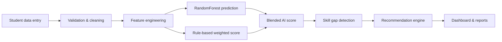
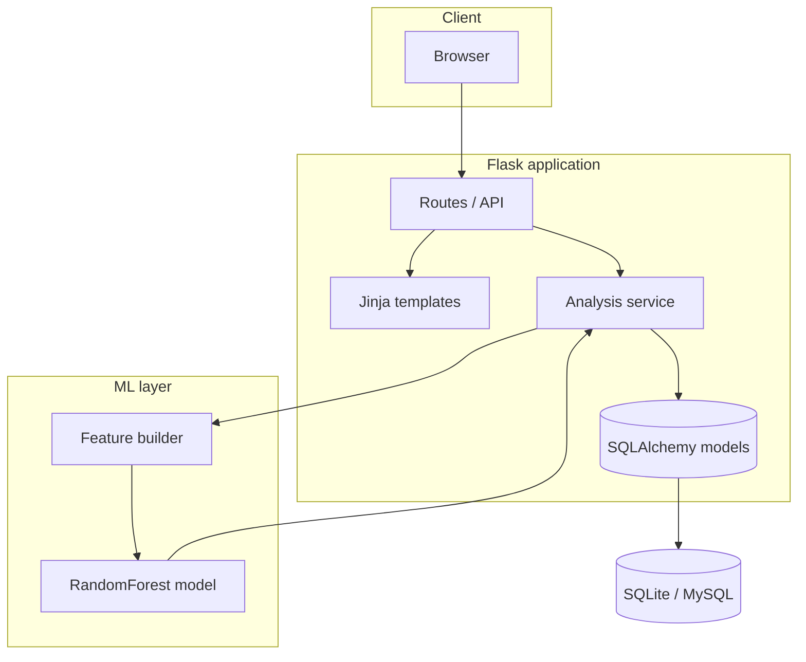
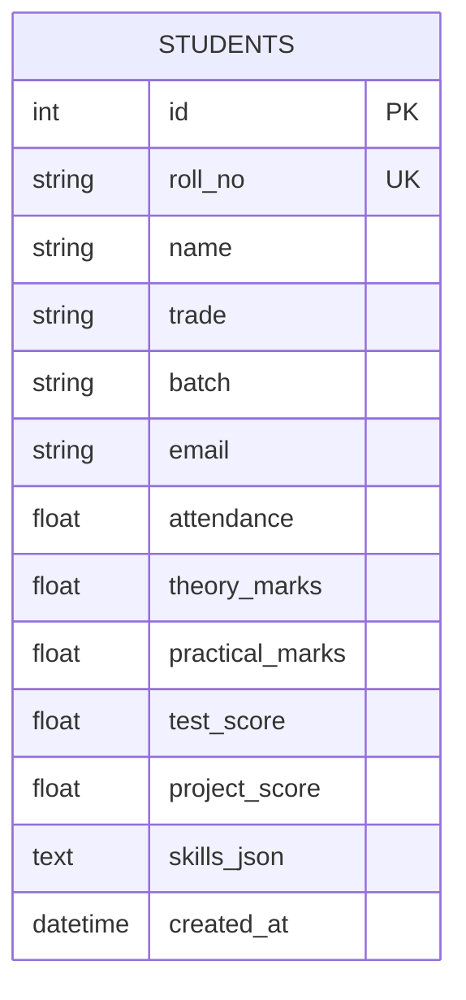

# Project Report

## AI-Based Student Performance & Skill Gap Analyzer

| Field | Details |
| --- | --- |
| Student | Mukesh Kumar |
| Trade | Computer Software Application (CSA) |
| Course | CITS |
| Institute | NSTI Kanpur |
| Session | 2026-27 |
| Technology | Python, Flask, MySQL/SQLite, pandas, scikit-learn, HTML/CSS/JavaScript |

---

## 1. Abstract

Training institutes record student performance across several separate registers —
attendance, theory marks, practical marks, periodic tests, project work and technical
skills. Combining these records manually is slow and makes it difficult for a trainer to
identify individual weaknesses early.

This project builds a web-based **Student Performance & Skill Gap Analyzer** that collects
those inputs, predicts an overall performance score using a machine-learning model,
compares every skill with its expected level, and generates a personalised learning plan.
Trainers get a single dashboard showing class averages, at-risk students, the weakest
skills in the batch, and a detailed report for each student. The application is built with
Flask, a SQL database, pandas and scikit-learn, and exposes both an HTML interface and a
JSON API. A dependency-free static version of the dashboard is published on GitHub Pages,
while the full application is deployed on Render.

## 2. Introduction

Skill development programmes such as CITS evaluate students on multiple dimensions.
A student may score well in theory but struggle with a specific tool, or attend regularly
yet fall behind in practical work. Looking at each column separately hides these patterns.

The project treats performance as a **multi-dimensional signal**. Academic indicators and
skill scores are combined into a single, explainable score, and the difference between a
student's current skill level and the expected level becomes an actionable "skill gap".
The output is not just a number: it names the gaps, ranks them by severity, and suggests
what to practise next.

## 3. Problem statement

In many training institutes, student performance is still reviewed manually using separate
records of academic marks, attendance, practical performance, test scores and technical
skills. Combining this information by hand is time-consuming and makes it difficult for
trainers to identify each student's individual weaknesses and provide personalised
guidance.

## 4. Objectives

1. Collect academic, attendance, practical, test, project and skill data in one place.
2. Predict an overall performance score using machine learning.
3. Detect individual skill gaps against expected levels.
4. Generate personalised learning recommendations.
5. Present cohort-level insights so trainers can prioritise their attention.
6. Keep the scoring explainable and reproducible.

## 5. Scope

**Included**

- Single-institute, single-batch student records
- Eight tracked skills (Python, Java, MySQL, HTML/CSS, JavaScript, C/C++, MS Office, Soft Skills)
- Performance prediction, gap detection, recommendations, cohort dashboard
- Web UI, JSON API, static demo, deployment configuration

**Excluded (future scope)**

- Multi-institute tenancy and role-based authentication
- Direct integration with examination systems
- Automatic retraining from production data

## 6. Methodology



1. **Data collection** — the trainer enters academic metrics and a score (0-100) for each
   tracked skill through the web form or the JSON API.
2. **Data processing** — values are clamped to 0-100, missing skills default to zero, and
   the average and minimum skill levels are derived.
3. **AI/ML analysis** — a `RandomForestRegressor` trained on 1,500 deterministic synthetic
   records predicts the overall score from seven features.
4. **Performance evaluation** — the prediction is blended with a transparent weighted
   score (`0.7 × ML + 0.3 × rule`) and mapped to a level band.
5. **Skill gap detection** — every skill below its expected level (60) is recorded with a
   severity of *critical*, *moderate* or *minor*.
6. **Recommendation** — the three largest gaps map to concrete practice actions and
   resources; a stretch recommendation is produced when no gaps remain.

## 7. System architecture



The application follows a layered structure: routes handle HTTP, the analysis service
owns scoring and recommendation logic, the ML layer isolates feature engineering and model
loading, and SQLAlchemy isolates persistence so SQLite can be swapped for MySQL through a
single environment variable.

## 8. Data model



Skill scores are stored as JSON text so new skills can be added without a schema change,
while remaining portable between SQLite and MySQL.

## 9. Modules

| Module | File | Responsibility |
| --- | --- | --- |
| Web application | `app.py` | App factory, pages, JSON API, validation |
| Data model | `models.py` | Student entity, skill (de)serialisation |
| Demo data | `seed.py` | Eight realistic CSA students seeded on first run |
| ML engine | `ml/analyzer.py` | Feature building, model training, gaps, recommendations, cohort stats |
| Model training | `ml/train_model.py` | Retrain and print MAE, R² and feature importance |
| UI | `templates/`, `static/` | Dashboard, student report, add-student form |
| Static demo | `docs/` | Browser-only version for GitHub Pages |
| Tests | `tests/` | 11 unit tests over the analysis engine |

## 10. Algorithms

### 10.1 Rule score

```
rule = 0.10·attendance + 0.20·theory + 0.25·practical
     + 0.20·tests + 0.15·project + 0.10·avg_skill
```

Practical work carries the highest weight because the CITS CSA course is skill-oriented.

### 10.2 ML score

`RandomForestRegressor(n_estimators=300, max_depth=9, min_samples_leaf=3, random_state=42)`
trained on features `[attendance, theory, practical, test, project, avg_skill, min_skill]`.
Synthetic records are generated from a latent ability factor so correlations resemble real
institute data; the seed makes every run reproducible.

Typical held-out quality: **R² ≈ 0.96–0.98**, **MAE ≈ 2 marks**.

### 10.3 Blended score and levels

```
overall = 0.7 × ML + 0.3 × rule
```

| Range | Level |
| --- | --- |
| ≥ 85 | Excellent |
| 70–84.9 | Good |
| 55–69.9 | Average |
| < 55 | Needs Improvement |

### 10.4 Gap severity

| Gap (expected − actual) | Severity |
| --- | --- |
| ≥ 20 | critical |
| 10–19.9 | moderate |
| < 10 | minor |

### 10.5 Risk classification

| Condition | Risk |
| --- | --- |
| score < 55 or attendance < 60 | High |
| score < 70 or attendance < 75 | Medium |
| otherwise | Low |

## 11. Testing

| # | Test | Expected result | Status |
| --- | --- | --- | --- |
| 1 | Grade band boundaries | Correct label at 85 / 70 / 55 | Pass |
| 2 | Score range | 0 ≤ score ≤ 100 | Pass |
| 3 | Strong vs weak student | Strong student scores higher | Pass |
| 4 | Low-skill detection | Python and JavaScript flagged | Pass |
| 5 | Severity calculation | 20-point gap is critical | Pass |
| 6 | Recommendation mapping | MySQL gap → SQL action | Pass |
| 7 | No-gap fallback | "Overall" stretch recommendation | Pass |
| 8 | Empty skills input | No crash, all skills reported | Pass |
| 9 | Batch vs single analysis | Identical scores | Pass |
| 10 | Cohort aggregation | Totals, weakest ≤ strongest | Pass |
| 11 | Empty cohort | Zeroed summary | Pass |
| 12 | Model quality | R² ≥ 0.9, MAE < 5 | Pass |

Run with:

```powershell
python -m unittest discover -s tests -v
```

## 12. Results

- A trainer can add a student in under a minute and immediately see the AI score, level,
  risk, top skill gaps and a three-step learning plan.
- The dashboard summarises the whole batch: average score, at-risk count, weakest and
  strongest skills, top performers and model feature importance.
- The same data is available as JSON for future integrations.
- The static demo reproduces the scoring and recommendation logic with no backend,
  making the project easy to showcase on GitHub Pages.

## 13. Limitations

- The model is trained on synthetic data; predictions are indicative until retrained on
  real, anonymised institute records.
- Skill scores are entered manually; there is no automated assessment integration.
- The free Render tier uses an ephemeral disk, so SQLite data resets on redeploy unless a
  managed database is attached.
- No authentication: the app assumes a trusted, single-trainer environment.

## 14. Future scope

1. Bulk import from CSV/Excel.
2. Trainer accounts with batch-wise permissions.
3. PDF report export per student.
4. Retraining pipeline fed by real institute data with drift monitoring.
5. Notifications for high-risk students via email/WhatsApp.
6. Mobile-friendly progressive web app.

## 15. Conclusion

The AI-Based Student Performance & Skill Gap Analyzer converts scattered records into a
clear, explainable performance picture. By combining a machine-learning prediction with a
transparent weighted score, it keeps results both accurate and understandable. Skill-gap
detection and personalised recommendations help trainers act on the data instead of merely
recording it, supporting more effective skill development in CITS training programmes.

## 16. References

1. Herbert Schildt, *Java: The Complete Reference*, McGraw Hill.
2. Flask documentation — <https://flask.palletsprojects.com>
3. scikit-learn user guide — <https://scikit-learn.org/stable/user_guide.html>
4. pandas documentation — <https://pandas.pydata.org/docs/>
5. SQLAlchemy documentation — <https://docs.sqlalchemy.org>
6. MDN Web Docs — <https://developer.mozilla.org>
